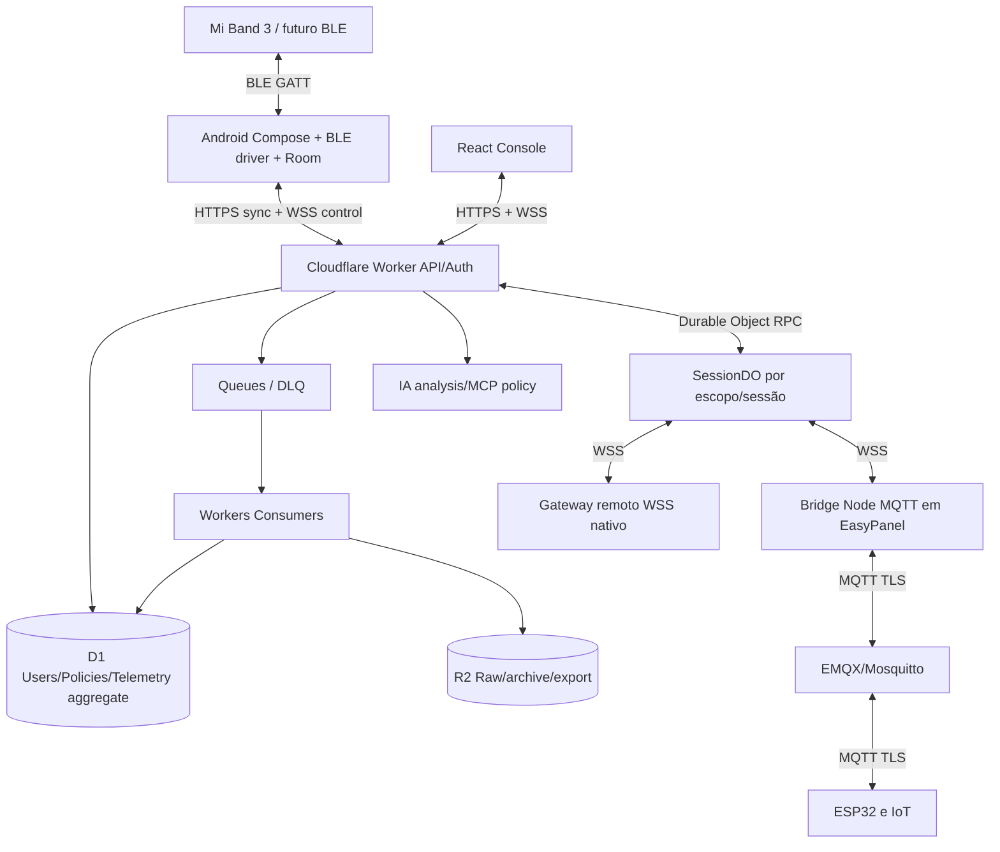

# 03 — Arquitetura de referência (C4 resumido)

## 1. Desenho lógico

## 2. Fronteiras de confiança
1. Pulseira ↔ Android: BLE sem confiança na origem dos pacotes; autenticação/chaves no Android Keystore; parâmetros/packets validados; dispositivo oficial ou clone sinalizado.
2. Android ↔ Edge: TLS + token de sessão do usuário + prova de identidade do gateway + device binding; tamanho/schema/rate limit; autorização por usuário/tenant.
3. Console ↔ Edge: cookies HttpOnly/SameSite/CSRF para web; MFA em funções privilegiadas; RBAC+ABAC.
4. Worker ↔ DO: binding interno, claims validadas pela API; não confiar em payload do cliente.
5. DO ↔ gateway IoT: sessões tokenizadas curtíssimas e whitelists de equipamento/ação; expiração e watchdog físicos.
6. AI ↔ ferramentas: ferramentas com contratos e políticas; prompts ou dados de sensores são input não confiável.

## 3. Components e ownership
- `apps/android`: UI, permissão, BLE GATT, perfis de device, Room, sync/WorkManager, WSS/foreground/companion, reconhecimento local, alertas e cache.
- `apps/api`: Hono/TypeScript Zod, REST auth, tenancy, ingestão, relatórios, IoT, billing, consent.
- `apps/realtime`: DO classe `PulseSessionRoom`; WebSocket Hibernation API, lookup de participantes, sequenciamento, controlo e TTL.
- `apps/console`: React/Vite/Tailwind, TanStack Query/Router, dashboards e administração; assets na Cloudflare.
- `apps/bridge-mqtt`: TS/Node container, único adaptador para broker TLS, padrões de tópicos ACL, restart/backoff.
- `apps/esp32-demo`: firmware de demonstração de LED/relé seguro em bancada com watchdog local, sem carga perigosa.
- `packages/contracts`: schemas Zod/JSON Schema e OpenAPI, WS event definitions e geração de clientes.
- `packages/core`: tipos/erros/regras e lógica pura sem ambiente.
- `packages/sdk-ts`: cliente tipado HTTP/WSS para integrações.

## 4. Taxonomia de dados
- **Metadata transacional:** usuários, tenants, dispositivos, permissões, vínculos, automações e auditoria → D1 (escalonamento por tenant se necessário).
- **Raw high-rate samples:** buffer efêmero Android, gravações experimentais consentidas → armazenamento local/R2 por lote; NÃO escrita D1 por amostra.
- **Time series padronizada:** eventos discretos/agregações de 1/5/60 minutos → D1 por partição lógica e retenção; considerar analytics/DB dedicado se throughput justificar.
- **Live:** DO em memória/sessão + attachment serializado; sessão/política persistida em D1/DO Storage; sem dependência de memória durante hibernação.
- **AI memory:** preferências explicitamente consentidas; não usar embeddings com dados sensíveis sem consentimento.

## 5. Consistência e deduplicação
- Cliente atribui `reading_id` ULID/UUID estável no ato da coleta e mantém offline até ACK remoto; servidor unique (`tenant_id`,`reading_id`).
- Eventos controlados identificados por `command_id`, `session_id`, `seq`, `expires_at` e `policy_version`.
- Ações não idempotentes exigem acknowledgement + chave armazenada no gateway do equipamento e expiração.
- Estados WS não são fonte autoritativa: após hibernar reconstrua de D1/DO Storage e webSocket attachments.

## 6. Escalabilidade
Sharding lógico por `tenant_id` e `session_id` (DO por sessão com bounded participants); enfileirar persistência e agregações; fan-out com quotas; grupos familiares separados; TTL para high-rate, downsampling para dashboards; limites D1 monitorados; exportações grandes em R2 com URL assinada.

## 7. Falhas e degradação elegante
- BLE ausente: app só mostra último dado com carimbo de idade.
- Android offline: usa fila persistente, com backpressure e quotas.
- Cloudflare 5xx: backoff com jitter, nenhum comando físico reenviado após prazo.
- WS drop: desarmar sessões físicas, reautenticar; dashboard alterna para HTTP.
- MQTT broker indisponível: comando não executado, estado timeout, reporta falha; nunca considerar envio=execução.
- IA indisponível: métricas continuam, regras determinísticas continuam, explicações marcadas indisponíveis.

## Extensão v1.1 — atualização de interface do wearable
Fluxo separado da telemetria/controle: `Theme Studio (Console)` → `build worker isolado + revisão/assinatura` → `R2 privado/D1` → `Worker Theme Catalog + ticket URL` → `Pulse Android valida assinatura/hash/compatibilidade` → `GATT OTA `.res` local` → `Android postcheck + journal` → `Worker Install events + audit`. WebSocket apenas transmite **status de instalação**, jamais bytes de firmware ou comando autônomo de flash. O Android mantém assinatura/verificação mesmo diante de console ou servidor comprometido, com chave pública confiável e política de revogação. Consulte docs 34–36.
