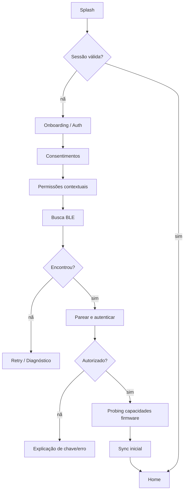
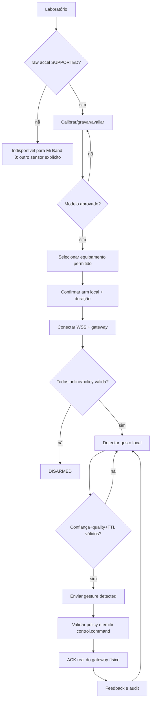
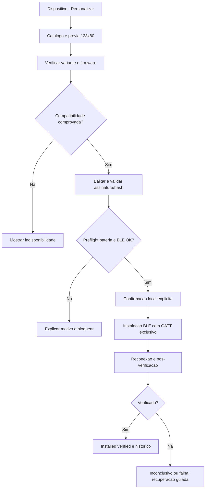

# 32 — Wireflows e critérios UI detalhados

## Fluxo instalação → dispositivo

## Fluxo gesto seguro

## Estados e microcopy padrão
- `UNVERIFIED`: 'Este modelo/firmware ainda não teve o envio contínuo de movimentos validado. O controle por gestos está desativado.'
- `STALE`: 'Última atualização: há X minutos. Os dados podem não refletir o momento atual.'
- `BLE_DENIED`: 'Para conectar sua pulseira, permita dispositivos próximos nas configurações.'
- `OFFLINE`: 'Sem conexão com a nuvem. Seus dados permanecerão neste aparelho e serão sincronizados ao retornar a internet.'
- `DISARMED`: 'Controle remoto desativado. Os movimentos não acionam equipamentos.'
- `CONTROL_REJECTED`: 'Comando não executado: sessão expirada ou autorização insuficiente.'
- `LOW_QUALITY`: 'Leitura com baixa qualidade; não será usada para acionar alertas.'

## Testes visuais
Criar screenshot/golden Compose para A01–A76 (normal/empty/error/unsupported) e Playwright snapshots do console em larguras 360, 768, 1280, 1920; legibilidade em pt-BR, font scale, contraste e teclado.

## Fluxo de temas e atualização

Todas as transições remotas de status exigem `attempt_id` e só podem relatar (não iniciar) flash. Fonte de verdade do progresso é journal Android e ACK do dispositivo.
